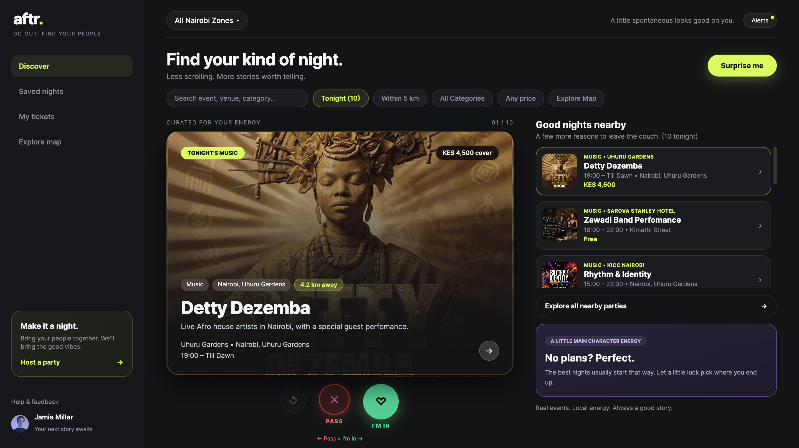

# aftr.

**Go out. Find your people.**

aftr. is a web application for discovering, saving, and booking nights out in Nairobi. It replaces endless scrolling through event listings with a swipe-based discovery experience, then takes users from "I'm in" to a QR entry pass in a single flow. It also gives organizers the tools to publish events and check guests in at the door.

## Overview

Finding something to do in a busy city often means juggling social feeds, group chats, and ticketing sites. aftr. brings the whole journey into one place: discover an event, save it, buy a ticket, and walk in with a scannable pass. Hosts get an equally simple path to list an event and verify attendance.


## Screenshot


## Key Features

Finding something to do in a busy city often means juggling social feeds, group chats, and ticketing sites. aftr. brings the whole journey into one place: discover an event, save it, buy a ticket, and walk in with a scannable pass. Hosts get an equally simple path to list an event and verify attendance.

## Key Features

**Design & Wireframes:**

 [View the Figma Design](https://www.figma.com/design/7PyxrcXITLG6mFkHLJsXun/Untitled?node-id=0-1&t=x3lrVHIz44tagu7q-1)

---

## Project Structure


### Discovery

- **Swipe deck:** pass or save events with gestures, buttons, or keyboard shortcuts, with undo support.
- **Surprise Me:** a randomized picker that can be narrowed by music, proximity, budget, or free entry.
- **Search and filters:** live search across titles, venues, categories, and prices, with filters for category, free events, and distance from central Nairobi.
- **Location zones:** browse by venue or area across the city.
- **Explore Map:** an interactive map and list view of nearby events, linked directly from each card.

### Saved Nights

- A personal shortlist with category filters and sorting by time or price.
- A direct path from a saved night to checkout.

### Checkout and Ticketing

- Regular and VIP tiers, quantity selection, and promo codes.
- Payment via M-Pesa Express (STK push flow) or card, with a timed seat hold.
- Instant QR entry passes stored in **My Tickets**.
- Calendar export (`.ics`), downloadable receipts, printing, and sharing.
- A ticket lifecycle that matches real use: attended passes clear after the event, and unused paid tickets remain for 7 days with a built-in refund request.

### For Organizers

- **Host portal:** publish an event with a live card preview, using the same schema as the main data set.
- **Gate scanner:** verify passes by camera QR scan (where supported) or reference code, and mark guests as attended, with duplicate-scan detection.

## Technology Stack

| Area        | Technology                                                            |
| ----------- | --------------------------------------------------------------------- |
| Front end   | React with React Router                                               |
| Styling     | Tailwind CSS                                                          |
| Data        | JSON Server (`server/db.json`) with a bundled offline fallback        |
| Tickets     | `qrcode.react` for QR generation; browser `BarcodeDetector` scanning  |
| Persistence | `localStorage` and `sessionStorage` for tickets and hosted events     |
| Testing     | React Testing Library with Jest / Vitest                              |

## Design Principles

- **Resilient by default:** the app falls back to bundled data when the API is unavailable.
- **Local-first:** built around Nairobi, with East Africa Time (UTC+3) for ticket expiry and refund windows, and KES pricing.
- **Accessible interactions:** semantic markup, labelled controls, and keyboard support.

## Scope Note

Payments are simulated in a sandbox, so no real money moves. Tickets and hosted events are stored in the browser. A production release would need a backend for payment processing, authentication, and server-side ticket validation.

## Getting Started

```bash
# install dependencies
npm install

# start the mock API (json-server)
npm run server

# start the app
npm run dev

# run the tests
npm test
```

## Team